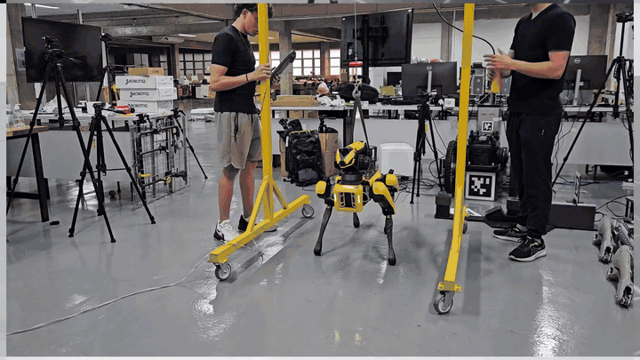

# Mind the Phase: Effective Rank and Representation Health in Legged Locomotion

**[Felipe&nbsp;Tommaselli](https://felipe-tommaselli.github.io/)** &ensp; [Ricardo&nbsp;V.&nbsp;Godoy](https://www.ricardovgodoy.com/) &ensp; Thiago&nbsp;H.&nbsp;Segreto &ensp; Juliano&nbsp;D.&nbsp;Negri &ensp; Marcelo&nbsp;Becker  
🥂 Accepted at CoRL 2026

**[Paper&nbsp;↗](https://arxiv.org/abs/2609.06958)** &ensp;
**[Project&nbsp;↗](https://felipe-tommaselli.github.io/mindthephase/)** &ensp;
**[Video&nbsp;↗](https://www.youtube.com/watch?v=yegSB-u0E1s)** &ensp;
**[Citation&nbsp;](#citation)**



Research code and supplementary material for effective rank analysis in legged locomotion. Feel free to open an issue or reach out to the authors if you have any questions.

## Install

To install this project, you can use the uv package manager.
1. **Install [uv](https://astral.sh/uv)**
```
curl -LsSf https://astral.sh/uv/install.sh | sh
```
2. **Install dependencies**
```bash
git submodule update --init IsaacLab
uv sync --locked
```

## W&B setup

```bash
uv run wandb login
export WANDB_PROJECT="<your-project>" # default: mindthephase
```

Keep credentials out of the repository.


## Train and Play

```bash
uv run scripts/rsl_rl/train.py --task Isaac-Spot-Locomotion-v0 --headless
uv run scripts/rsl_rl/play.py --task Isaac-Spot-Locomotion-Play-v0 --center
```

or explore more with:


| Robot | MLP | SimBa |
|---|---|---|
| Spot | `Isaac-Spot-Locomotion-v0` | `Isaac-Spot-Locomotion-Simba-v0` |
| Spot flat | `Isaac-Velocity-Flat-Spot-MLP-v0` | `Isaac-Velocity-Flat-Spot-Simba-v0` |
| ANYmal D | `Isaac-Velocity-Rough-Anymal-D-v0` | `Isaac-Velocity-Rough-Anymal-D-Simba-v0` |
| H1 | `Isaac-Velocity-Rough-H1-v0` | `Isaac-Velocity-Rough-H1-Simba-v0` |

## Investigator

[Investigator](scripts/rsl_rl/investigator.py) is attached to every training run.
Check `history.json` to understand more about the logging metrics we used.

> obs: it might be overwhelming at first, since investigator logs contemplate all metrics including the appendix. focus on the Jacobian and effective rank metrics first!


## Third-Party Code

Training uses RSL-RL. The entry scripts adapt
[IsaacLabExtensionTemplate](https://github.com/isaac-sim/IsaacLabExtensionTemplate),
and Spot simulation is based on [Relic](https://github.com/rai-opensource/relic).
See [LICENSE](LICENSE): the Spot assets and actuators are for non-commercial
research use only.

## Citation

```bibtex
@inproceedings{tommaselli2026mind,
  author = {Tommaselli, Felipe and Godoy, Ricardo V. and Segreto, Thiago H. and Negri, Juliano D. and Becker, Marcelo},
  title = {{Mind the Phase: Effective Rank and Representation Health in Legged Locomotion}},
  booktitle = {Conference on Robot Learning (CoRL)},
  year = {2026},
  eprint = {2609.06958},
  archivePrefix = {arXiv},
  primaryClass = {cs.RO}
}
```
